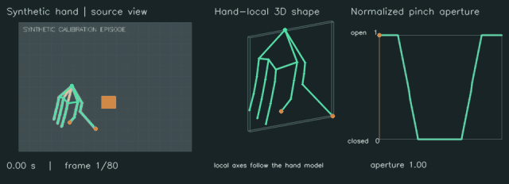
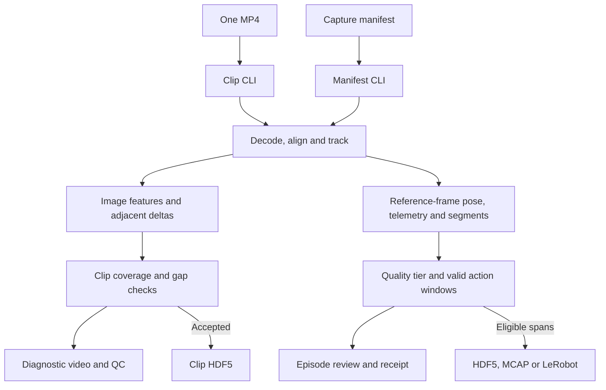

# EGO-VTA

EGO-VTA (Egocentric Video-to-Action) measures hand motion and pinch aperture in manipulation recordings. Start with one MP4 and the CPU tracker. A separate calibrated workflow supports tracked cameras, sensor data and policy-format exports.



The preview uses known synthetic landmarks to illustrate the output. The public-video measurements in the [build plan](BUILD_PLAN.md) use the CPU hand detector.

## Choose a first run

| You have | Run | What success looks like |
| --- | --- | --- |
| A clean CPU checkout | `ego-vta demo work/baseline` | Four seconds of synthetic moving-camera data produce 76 training rows, HDF5 and MCAP |
| A phone or glasses MP4 | `ego-vta-clip` | Trace a selected hand through the diagnostic video and inspect the per-row masks in an accepted feature file |
| A cloud CPU and no recording | `python tools/cloud_smoke.py` | Process the original EgoDex sticker and pour clips, reopen sticker tensors and reject the full pour clip with diagnostics |
| A synchronized capture manifest | `ego-vta run` | Inspect coordinate frames, QC tier, valid spans, selected exports and the processing receipt |

### Fresh install on Linux or macOS

Start in the repository root. For a new checkout, run `git clone https://github.com/Jeffimpact/EGO-VTA.git` and `cd EGO-VTA`. Use Python 3.12 for the examples. On a minimal Debian/Ubuntu cloud image, provision the system libraries listed in the [Dockerfile](Dockerfile) during setup, including EGL, GLES, GL, GLib and PortAudio.

```sh
python3.12 -m venv .venv
source .venv/bin/activate
python -m pip install -e '.[tracking]'
ego-vta --help
ego-vta demo work/baseline
python -m unittest discover -s tests -v
```

Inspect `work/baseline/result/episode.json` for the tier, training rows and formats. Open `review.mp4` beside it. The test runner is Python's standard-library unittest. The native LeRobot reader test skips when that optional package is absent. For a second shell, reactivate the same virtual environment. Use a fresh output path when changing inputs or options.

## Architecture and data flow



The clip CLI selects the feature branch and the manifest CLI selects the reference-frame branch. Both reuse the decoder and tracking code. In a rejected run, the review files explain which observations failed.

| Modules under `src/ego_action/` | Responsibility and output |
| --- | --- |
| `cli.py`, `clip.py`, `pipeline.py` | Dispatch commands, orchestrate the clip or manifest job, and publish completed output directories |
| `ingest.py`, `pose.py` | Decode presentation times, align cameras and sensors, estimate hand geometry and compute relative-pose targets |
| `labels.py`, `quality.py` | Import or propose segment instructions, score evidence, flag bad frames and determine eligible spans |
| `exporters.py` | Serialize manifest-route images, action chunks and metadata to the selected formats |
| `review.py`, `inspector.html`, `streamlit_app.py` | Render synchronized video, trajectory, aperture and frame-level QC for inspection |
| `demo.py`, `staging.py`, `monitor.py`, `common.py` | Generate known-motion fixtures, transfer versioned captures, emit live rig alerts, and supply shared I/O and validation helpers |

### Repository and generated files

| Path | Function |
| --- | --- |
| `pyproject.toml`, `Dockerfile` | Package requirements, optional dependencies, CLI entry points and Linux container setup |
| `src/pipeline/run.py` | Repository-root compatibility entry point for the single-video CLI |
| `tools/` | Download the EgoDex subset, compare aperture with independent labels and run the two-clip cloud smoke check |
| `tests/` | Exercise clip masks, calibrated motion, reader agreement, quarantine, retries and staging |
| `docs/`, `BUILD_PLAN.md` | Input and engineering contracts, pilot roadmap, synthetic preview and baseline measurements |
| `data/raw/` | Downloaded public MP4s and paired reference HDF5s. The reference is used for evaluation |
| `data/exports/cloud/{sticker,pour}/` | Per-clip diagnostic and QC. The accepted sticker folder also contains `episode.h5` |
| `work/baseline/capture/` | Generated input manifest, synthetic video, telemetry, annotations and independent ground truth |
| `work/baseline/result/` | Review MP4, frames CSV, episode metadata and receipt. Eligible synthetic exports live under `synthetic/tier-1/`. Failed episodes have `quarantine/diagnostics.json` |

[Engineering specification](docs/ENGINEERING_SPECIFICATION.md) · [Next milestones and hardware decisions](docs/ROADMAP.md) · [Manifest fields and units](docs/INPUTS.md)

## Process one phone video

After the tracking install, run MediaPipe on CPU with a local recording.

```sh
ego-vta-clip --input my_clip.mp4 --seconds 15 --output-dir data/exports/first --gif
```

Substitute any local MP4 for the input. A 15-second desk view of a hand pinching and lifting a pen is a suitable controlled test. Start with the phone stationary. Use a head- or chest-mounted phone for a separate moving-camera trial. The first run retrieves Google's pinned 7.8 MB hand model and verifies its checksum. To run offline, pass a pre-downloaded bundle with `--model path/to/hand_landmarker.task`. On Linux install the EGL and GLES runtime libraries if the MediaPipe wheel requests them.

**Outputs.** `diagnostic.mp4` shows the video with 21 joints, an oblique view of the hand-local 3-D skeleton and its bounding box, and a pinch-aperture curve with a synchronized cursor. `episode.h5` contains the observation and proxy-action tensors when the clip meets the quality gates. `qc.json` records every gap and each valid interval. A rejected clip keeps its diagnostic and QC report, returns exit status 3, and emits no accepted tensor file. The optional `--gif` writes up to ten seconds for a portfolio. Use your own footage for the public example.

| Dataset in the clip HDF5 | Contract |
| --- | --- |
| `images` | RGB uint8, `(T,224,224,3)` |
| `timestamp_ns`, `source_timestamp_ns`, `source_frame_index` | Uniform 20 Hz target clock, actual exposure and original decoded frame |
| `hand/landmarks_uv`, `hand/landmarks_hand_centered_m` | 21 image landmarks and the model's hand-centered 3-D estimate |
| `state` | `(T,4)`. For plain RGB the fields are wrist u, wrist v, projected palm span in image heights, and normalized pinch aperture |
| `actions` | `(T,4)` human proxies. Deltas of the first three state fields and next-frame aperture. Invalid transitions, including the terminal row, contain NaN |
| `valid/landmarks`, `valid/action` | Boolean masks for each time step. Missing hands are never filled with zero-valued observations |
| `synthetic/imu`, `synthetic/fmg` | Present with `--mock-sensors`. Raw 100 Hz samples, aligned values, age, and synthetic provenance. Excluded from grading |

Aperture uses 3-D thumb–index distance divided by palm width. Use `--pinch-range CLOSED OPEN` to calibrate the [0,1] scale with an open-hand and pinch recording. The defaults are illustrative. Single-camera RGB has no metric wrist-depth label in this profile. A camera calibration JSON with `K`, `D`, `model`, `image_size`, and measured `palm_width_m` enables estimated camera-frame XYZ via PnP. Head motion still affects that frame. The calibrated pipeline described below can additionally use a tracked camera pose.

**Reproduce the real-video test without a camera.** The helper fetches individual unmodified MP4s and paired ARKit reference files from Apple's archive using HTTP byte ranges. The default two episodes are under 30 MB of video. The sticker clip supplies a sustained hand track; the untrimmed pour clip exercises rejection.

```sh
python tools/fetch_egodex.py data/raw
python -m src.pipeline.run --input data/raw/sample_peel_place_sticker.mp4 --seconds 15 --output-dir data/exports/sticker --mock-sensors --gif
```

Run `python tools/check_pinch.py data/exports/sticker/episode.h5 data/raw/sample_peel_place_sticker.hdf5` to compare the raw aperture ratio against the paired ARKit reference. `--start-second` and `--seconds` select a window on the original video clock.

Use `--hand Left` when the left hand is the subject. The strict whole-clip gate rejects over 5% invalid observations or a gap longer than five 20 Hz frames. An optional `--pitch-csv` with calibrated `timestamp_ns,pitch_deg` enables the 35° pitch gate. With video alone, the report names the observed tracking loss and marks pitch unmeasured. See [the build plan and benchmark results](BUILD_PLAN.md).

## Run in a cloud checkout

From the repository root in a Python 3.12 environment, run the CPU checks below. The smoke run downloads two original EgoDex clips and the pinned model on first use. It checks the 15-second tensor and diagnostic video, the independent aperture comparison, and a rejected pour episode. Outputs are written under `data/exports/cloud/`.

```sh
python -m pip install -e '.[tracking]'
python -m unittest discover -s tests -v
python tools/cloud_smoke.py
```

**Verified cloud run.** At commit `585f570` on Python 3.12.14, the tracking install passed 21 tests and skipped the optional reader. With LeRobot 0.7.0 installed, all 22 passed. The synthetic demo exported 76 anchors from 80 observations. The sticker clip had 295/300 valid hand rows and 291 valid transitions. The full pour clip had 90/127 valid hand rows and was rejected with a 36-row gap. The run decoded both diagnostic videos.

For a Codex environment with offline execution, use the install command plus the following two commands in its network-enabled setup phase. The test and smoke commands then use the local files. A minimal Linux image needs `libgl1`, `libegl1` and `libgles2` for the tracker.

```sh
python tools/fetch_egodex.py data/raw
python -c 'from ego_action.clip import model_path; print(model_path(None))'
```

## Generate the offline example

Run `ego-vta demo sample` after installation to generate a four-second synthetic recording under `sample/capture` and its processed outputs under `sample/result`. Use `ego-vta demo sample --formats hdf5,mcap,lerobot` in a fresh directory with the LeRobot extra to exercise all three formats. The virtual camera moves independently of the hand. Open `sample/result/review.mp4` to see the recording and `sample/result/episode.json` to inspect the quality decision. `ground_truth.csv` is an independent test oracle and is never read by the pipeline.

## Optional exporters and dashboard

Use Python 3.12 for all three exporters. The core supports Python 3.10 and later. On Linux with `uv` installed, the following commands select CPU PyTorch wheels. Run these in a fresh checkout or use a new environment name if you already created `.venv`. The initial install needs internet access.

```sh
uv venv --python 3.12 .venv
source .venv/bin/activate
uv pip install --torch-backend cpu -e '.[tracking,lerobot,dashboard]'
ego-vta demo sample --formats hdf5,mcap,lerobot
ego-vta inspect sample/result
```

For a smaller install, `python -m pip install -e .` installs the HDF5 and MCAP pipeline. Run `ego-vta demo work/good` with those defaults. The dashboard, detector, and LeRobot each have their own extra. The tracking wheel on Linux uses the system EGL and GLES libraries even for CPU inference. The Dockerfile installs those libraries.

| Command | Result |
| --- | --- |
| `ego-vta demo work/lost --fault occlusion` | A controlled tracking failure, a QC report, and a quarantine decision |
| `ego-vta demo work/force --fault force` | A visually closed grasp with no FMG activation, quarantined with a reason |
| `ego-vta run capture/episode.json work/run-01 --formats hdf5,mcap,lerobot` | Process a capture manifest and write selected formats |
| `ego-vta inspect work/run-01 --html review.html` | Single-file offline inspector with video, scrubber, 3-D wrist path, aperture, speed and segment text |
| `python -m unittest discover -s tests -v` | Check temporal alignment, known motion, file readers, failure cases, staging, and the local VLM contract |

The dashboard opens in a local browser. The offline HTML also works when the source recording and backend are elsewhere. Its size includes a copy of the review video.

## Use your own recording

```sh
ego-vta init-video recording.mp4 capture.json --task "Move the block into the tray" --model hand_landmarker.task
ego-vta run capture.json work/first-clip
```

For a first glasses clip, choose the hand in view with `--hand Right` or `--hand Left`. The initial manifest uses a moving-camera profile and records a preview. To produce metric actions, fill in the intrinsics, measured palm width, closed/open fingertip distances, and a fixed or tracked camera reference. For a fixed camera trial, set `reference` to `static_camera` only when the camera was stationary throughout the trial. A head-mounted recording supports a synchronized camera-pose CSV. A calibrated external landmark tracker can supply the 21 points directly. The generated aperture values are examples to replace with operator measurements. Google publishes the hand model bundle and API guide. [Hand Landmarker](https://ai.google.dev/edge/mediapipe/solutions/vision/hand_landmarker/python)

The input contract, channel names, transforms, sensor units, and quality defaults are in [docs/INPUTS.md](docs/INPUTS.md). The smallest trial can use a phone or glasses recording for visual inspection. Physical units and a stable frame of reference are required for the training route.

## Read the exported data

```python
import h5py
from pathlib import Path

tier = Path("sample/result/synthetic/tier-1").resolve()
with h5py.File(tier / "episodes.h5") as f:
    ep = f["data/episode_0000"]
    images = ep["observation/image_primary"]
    actions = ep["action/chunk"]
    print(images.shape, actions.shape)   # (76, 3, 224, 224), (76, 4, 7)

```

After generating the optional LeRobot export in the same sample directory, continue in the same Python session.

```python
from lerobot.datasets import LeRobotDataset

ds = LeRobotDataset("local/ego_action", root=tier / "lerobot", video_backend="pyav")
frame = ds[0]
print(frame["task"], frame["action"], frame["observation.images.primary"].shape)
```

For world-model targets, `target/future_observation_index` addresses `sequence/image_primary`, including the final horizon of frames. The HDF5 anchor image array is a same-file virtual view over those pixels. The canonical HDF5 file retains per-camera exposure times, source indices, optional telemetry validity, high-level task tokens, and segment IDs. LeRobot v3 is written by the official writer, including its MP4, Parquet, metadata, statistics, and task tables. Each contiguous span becomes a separate LeRobot episode. The ordinary `action` field is seven-dimensional. `action_chunk` stores the full anchor-relative horizon. ROS 2 MCAP includes CDR-encoded RGB images, poses, instructions, measured telemetry, and both one-step and chunked actions. A ROS installation is optional for writing or reading MCAP in Python. [LeRobot v3](https://huggingface.co/docs/lerobot/lerobot-dataset-v3) · [MCAP ROS 2 writer](https://mcap.dev/docs/python/mcap-ros2-apidoc/mcap_ros2.writer)

## Labels, staging, and edge feedback

The default automatic labeler proposes transitions from grasp changes and speed minima. Its generic captions identify motion and hand opening or closing. A local multimodal server can name objects and write imperative instructions. Set a model and loopback endpoint in the manifest, then remove the optional `annotations` entry to select automatic labeling. Each segment sends three ordered RGB keyframes to that server. The default request uses structured JSON output. Set `structured_output` to `false` for servers that support plain chat completions only. Imported human-reviewed annotations take precedence when supplied.

```json
{"vlm": {"url": "http://127.0.0.1:8080/v1/chat/completions", "model": "local-vlm", "timeout_s": 90}}
```

The CLI can stage immutable captures and retrieve them for processing. A versioned manifest appears after all input assets finish uploading. Retrieval checks each SHA-256 digest. Install `python -m pip install -e '.[s3]'` for staging support. Use a local directory or an S3 URI with your configured credentials. These commands run the same staging flow entirely on disk.

```sh
uri=$(ego-vta stage sample/capture/episode.json work/staging)
ego-vta fetch "$uri" work/downloaded
ego-vta run work/downloaded/episode.json work/from-staging
```

For live rig feedback, the capture driver can pipe JSON lines to `ego-vta monitor`. Each line carries integer `timestamp_ns` and calibrated `pitch_deg`, measured `lux`, or both. It emits active and cleared events when pitch drift exceeds 35° or measured illumination falls below 15 lux. Hardware acquisition drivers remain rig-specific.

## Reproducibility

Each successful manifest run contains the source hashes, selected exports and software version in `receipt.json`. An identical request reuses the result. Changed inputs require a new output directory. Failed processing leaves the input capture intact and publishes no partial dataset. Synthetic outputs use a distinct directory, and a quarantined recording produces review material and zero training rows.

For a containerized run from this directory:

```sh
docker build -t ego-vta .
docker run --rm -v "$PWD:/data" ego-vta demo /data/work/container-demo
```

See [BUILD_PLAN.md](BUILD_PLAN.md) for the implementation milestones, acceptance results, and the hardware decisions for a real pilot.

For the next pilot, record the same pinch-and-lift task with a fixed and a moving phone. Compare timing and coverage before choosing glasses, IMU/FMG or edge compute. Follow the [milestone roadmap](docs/ROADMAP.md) through calibration, simulation replay and physical evaluation.
